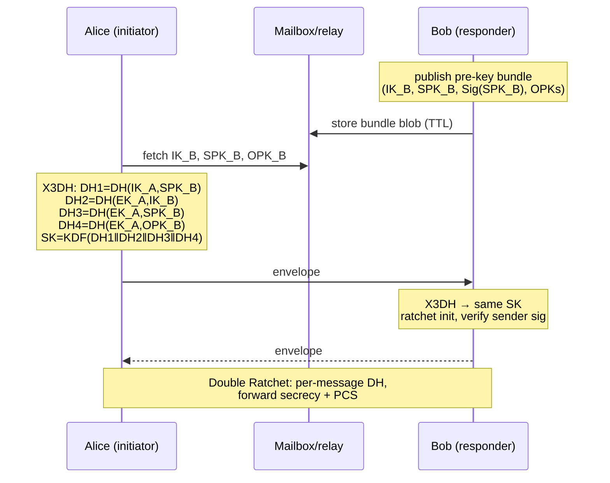

# PROTOCOL.md — Veil wire protocol v1

Normative specification. Types are implemented in `@veil/core`
(`src/messages.ts`, `src/codec.ts`, `src/topics.ts`, `src/mailbox.ts`);
the protobuf schema in `packages/core/proto/*.proto` is authoritative and is
pinned by `packages/core/test/conformance.test.ts`.

## 1. Identifiers

| Concept                 | Form                                | Notes                                                                             |
| ----------------------- | ----------------------------------- | --------------------------------------------------------------------------------- |
| Identity                | `did:key:z6Mk…`                     | Ed25519 pubkey, multicodec `ed25519-pub` (`0xed 0x01`) + base58btc, multibase `z` |
| Noise/X25519 static key | `z…`                                | multicodec `x25519-pub` (`0xec 0x01`)                                             |
| Device                  | `did:key` of the device signing key | equal to identity key for a single-device user                                    |
| Message id              | 64-char lowercase hex               | SHA-256 over canonical envelope bytes                                             |
| Conversation            | opaque string ≤ 128 chars           | DM: `<didA>.<didB>` sorted; group: random 128-bit id                              |
| Peer                    | libp2p `PeerId` (string)            | transport-local, not an identity                                                  |

Display names are **never** used in identifiers, topics, or relay traffic.

## 2. Topic naming (`veil/v1/…`)

| Topic                             | Purpose                                                                       |
| --------------------------------- | ----------------------------------------------------------------------------- |
| `veil/v1/dm/<pairId>`             | 1:1 conversation traffic (pairId = sorted, URI-encoded DIDs joined by `.`)    |
| `veil/v1/group/<groupId>`         | Group conversation traffic (GossipSub)                                        |
| `veil/v1/typing/<conversationId>` | Ephemeral typing indicators (never persisted)                                 |
| `veil/v1/presence`                | Liveness hints for contacts already in your address book                      |
| `veil/v1/mailbox/<recipientId>`   | Mailbox deposit notification (the item itself goes over the mailbox protocol) |

Topics are validated by `validateTopic`; anything outside the namespace is
rejected before it reaches the router.

## 3. Envelope (the only wire unit)

```proto
message Envelope {
  uint32 version = 1;      // 1
  string sender = 2;       // did:key
  string conversation = 3; // opaque
  uint32 bucket = 4;       // 512 | 2048 | 8192 | 32768
  bytes  payload = 5;      // ciphertext, exactly `bucket` bytes
  bytes  nonce = 6;        // 24 bytes
  HybridClock clock = 7;   // see §4
  uint64 sent_at_ms = 8;
  bytes  signature = 9;    // Ed25519 over §5
}
```

**Padding.** `payload` is always exactly `bucket` bytes:
`plaintext ‖ 0x00… ‖ uint16be(paddingLength)`, where `paddingLength` counts
padding bytes _including_ the 2-byte footer. Buckets: 512, 2048, 8192, 32768. `chooseBucket(n)` picks the smallest bucket ≥ `n + 2`; payloads larger
than 32766 bytes are rejected (`ENVELOPE_TOO_LARGE`).

**Nonce.** 24 bytes, unique per (sender, conversation); reused nonces are a
protocol violation and must drop the message.

**Size limit.** A full envelope must be ≤ 96 000 bytes on the wire
(`MAX_ENVELOPE_BYTES`); larger frames are dropped before parsing.

## 4. Hybrid logical clock

```proto
message HybridClock { uint64 lamport = 1; uint64 wall_ms = 2; string node_id = 3; }
```

- Local event: `tick()` → `lamport + 1`, `wall_ms = max(wall, now)`.
- Received event: `observe()` → `lamport = max(local, remote) + 1`.
- Total order: `(lamport, wall_ms, node_id)` lexicographically — used for
  rendering, dedup ordering and CRDT tie-breaks.
- Skew rule: a remote `wall_ms` further than 5 minutes in the future is
  clamped; it never drives local wall time beyond `now`.

## 5. Signature

Signatures are Ed25519 over `encodeEnvelopeSignatureBase()`:

```
uint32be(version) ‖ utf8(sender) ‖ utf8(conversation) ‖ uint32be(bucket)
‖ uint32be(len(payload)) ‖ payload ‖ nonce
‖ uint64be(lamport) ‖ uint64be(wall_ms) ‖ utf8(node_id) ‖ uint64be(sent_at_ms)
```

Including `version` means a downgrade attempt invalidates the signature.
Verification uses the key extracted from `sender` (`did:key`); unknown or
malformed senders are dropped (`MALFORMED_ENVELOPE`).

## 6. Version negotiation

- Every envelope carries `version`. Decoders accept `MIN_SUPPORTED_VERSION (1)
… PROTOCOL_VERSION (1)`; higher versions are rejected with
  `UNSUPPORTED_VERSION` (never silently reinterpreted).
- During connection setup the `identify` protocol exchanges protocol
  versions; `negotiateVersion()` picks `min(theirs, ours)`.
- New proto fields must be additive with new field numbers; decoders skip
  unknown fields (verified by a conformance test).

## 7. Handshake and key exchange flows

### 7.1 Session establishment (X3DH + Double Ratchet, 1:1)

Peers publish pre-key bundles (signed pre-key + one-time pre-keys) through
their mailbox; the first message carries the X3DH initialisation material
inside the padded, signed envelope.



Rules: every envelope after #1 is a Double Ratchet message; skipped-key
storage is bounded (max 2000 keys per conversation); a reused one-time
pre-key is accepted once, then flagged for re-publication.

### 7.2 Group keying (MLS, RFC 9420)

```mermaid
sequenceDiagram
    participant Admin as Group admin
    participant G as GossipSub topic<br/>veil/v1/group/<id>
    participant M as New member

    Admin->>G: MLS Welcome (path secret, epoch)
    Admin->>G: MLS Commit(add member)
    M-->>Admin: KeyPackage
    Admin->>G: Commit + Welcome for M
    Note over G: members advance epoch;<br/>old epochs are forward-secret
```

Group payloads are MLS application messages; the MLS group id is bound to the
`veil/v1/group/<groupId>` topic. Leaving = remove commit; admins sign roster
changes, and the roster CRDT (Phase 5) is advisory metadata only — MLS state
is authoritative for keying.

### 7.3 Device linking (QR)

```mermaid
sequenceDiagram
    participant Old as Existing device
    participant New as New device

    New->>New: generate ephemeral link keypair
    Old->>New: QR: { link_pubkey, relay hints, nonce }
    New->>Old: encrypted link request (X25519)
    Old->>New: encrypted identity export<br/>(seed wrapped to link_pubkey)
    Note over Old,New: Both derive device did:key;<br/>old device publishes device-list update
```

The identity seed never crosses in plaintext; it is sealed to the QR
ephemeral key and wiped from the transport layer immediately.

## 8. Mailbox store/retrieve protocol

Mailbox nodes are untrusted: they store only sealed `MailboxItem` blobs and
cannot read, correlate or replay them beyond the TTL.

```
STORE   { recipient_token, sealed_envelope, created_at, expires_at, pow_nonce }
RETRIEVE{ recipient_token, since?, auth_proof }        -> { items[], next_cursor? }
ACK     { recipient_token, item_ids[], auth_proof }
```

- `recipient_token` = HMAC(identity_noise_key, "veil-mailbox-v1") truncated to
  32 bytes — unlinkable across mailboxes.
- `auth_proof` = HMAC(recipient_token, challenge) issued on connect; constant-
  time compared server-side.
- `pow_nonce` proves a small amount of work for messages from unknown senders
  (anti-spam; difficulty 22 bits initially, adaptive).
- TTL default 14 days (`DEFAULT_MAILBOX_TTL_DAYS`), hard-capped; the node may
  garbage-collect anything older. Nodes learn: recipient token, size class,
  timestamps. Nothing else.
- Sealed envelope = AEAD(envelope, key = DH(noise_key_sender, noise_key_recipient)),
  so the mailbox never sees the inner Envelope.

## 9. Security invariants (checked by tests + review)

1. Every inbound envelope is size-limited, structurally validated and
   signature-verified **before** decryption or storage.
2. Nonce reuse per (sender, conversation) → drop + flag the peer.
3. Unknown-topic, wrong-namespace or oversized frames never parse.
4. No plaintext message content, keys or mnemonics in logs; error messages
   contain only codes and sizes.
5. All secret comparisons (auth proofs, tokens) are constant-time.
6. Padding buckets are enforced on both encode and decode.
